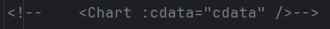
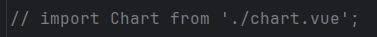
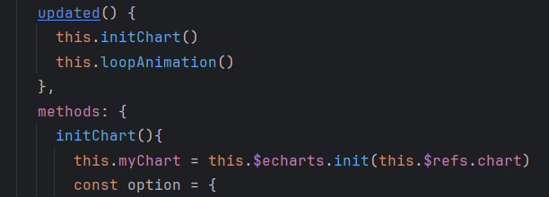
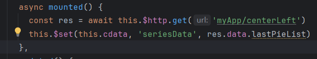

# 车辆大屏可视化

‍

### 1.使用的依赖和库

asgiref==3.5.2
async-generator==1.10
attrs==22.1.0
backports.zoneinfo==0.2.1
certifi==2022.6.15
cffi==1.15.1
cryptography==37.0.4
cycler=0.11.0
Django==3.1.14
fonttools==4.34.4
h11==0.13.0
idna==3.3
jieba==0.42.1
kiwisolver==1.4.4
matplotlib==3.5.2
numpy==1.23.1
outcome==1.2.0
packaging==21.3
pandas==1.4.3
Pillow==9.2.0
pycparser==2.21
PyMySQL==1.0.2
pyopenSSL==22.0.0
pyparsing==3.0.9
PySocks==1.7.1
python-dateutil==2.8.2
pytz==2022.1
six==1.16.0
sniffio==1.2.0
sortedcontainers==2.4.0
sqlparse==0.4.2
trio==0.21.0
trio-websocket==0.9.2
tzdata==2022.1
urllib3==1.26.11
wordcloud==1.8.2.2
wsproto==1.1.0
requests==2.31.0
lxml==4.9.3

### 2. settings文件配置

配置语言(zh-hans)、时区(Asia/Shanghai)和数据库(carData)

### 3. 创建爬虫文件

创建爬虫文件夹(`spiderMan`​)，创建爬虫文件`spiders.py`​，导入所需模块

#### 4.1 爬取数据

主要需要爬取的数据

```txt
"brand" 品牌
“carName" 车名
"carImg" 汽车图片
"saleVolume" 销量
"price" 价格
"manufacturer"厂商
"rank" 销量排名
"carModel" 车型
"energyType" 能源类型
"markeTime" 上市时间
"insure" 保修期限
```

#### 定义初始化方法和主方法。

**初始化**：方法里需要存储需要爬取的网页Url以及请求头`User-Agent`​。

#### `init`​方法：

创建一个temp.csv，并将后获取到的数据的列表导入到csv文件中。

#### main方法：

因为网页的数据采用滚动式加载，但发现网页只需要修改末尾的序号(每次从0-9为一页),所以需要一个`count`​来作为翻页的索引。

创建`spiderPage.txt`​文件用于存储count索引。

在main方法中`count值`​用一个`get方法`​从`spiderPage.txt`​文件获取，定义一个`pageJson`​变量，向网页发送请求并解析JSON响应，在提取数据列表，创建循环，用于获取每一条数据并利用一个列表接收，每次接收后都会使`count+10`​，以达到下一页。

获取数据

```python
    def main(self):
        count = self.get_page()
        params = {
            'offset':int(count)
        }
        print(f"数据从{int(count)+1}开始爬取")
        headers = self.headers
        pageJson = requests.get(self.spiderUrl, headers=headers, params=params).json()
        pageJson = pageJson['data']['list']
        try:
            for index, car in enumerate(pageJson):
                carData = []
                print(f"正在爬取第{index + 1}数据")
                # 品牌名
                carData.append(car['brand_name'])
                # 车名
                carData.append(car['series_name'])
                # 图片链接
                carData.append(car['image'])
                # 销量
                carData.append(car['count'])
                # 价格
                price = []
                price.append(car['min_price'])
                price.append(car['max_price'])
                carData.append(price)
                # 厂商
                carData.append(car['sub_brand_name'])
                # 销量排名
                carData.append(car['rank'])
                # 第二个页面
                carNumber = car['series_id']

                infoHTML = requests.get("https://www.dongchedi.com/auto/params-carIds-x-%s" % carNumber, headers=headers)
                infoHTMLpath = etree.HTML(infoHTML.text)
                # 车型
                carModel = infoHTMLpath.xpath("//div[@data-row-anchor='jb']/div[2]/div/text()")[0]
                carData.append(carModel)
                # 能源类型
                energyType = infoHTMLpath.xpath("//div[@data-row-anchor='fuel_form']/div[2]/div/text()")[0]
                carData.append(energyType)
                # 上市时间
                marketTime = infoHTMLpath.xpath("//div[@data-row-anchor='market_time']/div[2]/div/text()")[0]
                carData.append(marketTime)
                # 保修期限
                insure = infoHTMLpath.xpath("//div[@data-row-anchor='period']/div[2]/div/text()")[0]
                carData.append(insure)
                carData.append(insure)
                self.save_to_csv(carData)
            # print(pageJson)
            self.set_page(int(count) + 10)
            self.main()
        except:
            pass
        # print(pageJson)
        self.set_page(int(count) + 10)
        self.main()
```

> P.S.注意：
>
> 1. 在爬取能源类型时，出现爬出来了两个类型，可能原因是因为XPATH会匹配到所有符合条件的元素，而现代汽车可能有很多中能源类型。
> 2. ~~网站设置了防爬机制，在爬取到第90条时，程序直接退出了，需要添加随机请求头以及设置随机睡眠时间，但出现了爬十条或几十条数据就会停止，再次启动就可以了。(当然，修改前的爬虫方法可能也可以再次启动继续爬取，但是修改的地方有点多就不改了)~~ 最后发现原因时因为当程序报错是，我的递归直接结束了，应该把调用main()函数放在except外面

#### 4.2 建立数据库

**先注册APP！！！！！**

> P.S注意：在注册APP时出现错误提示(没有安装mysqlclint)可以直接在项目文件的Django包下的`__init__.py`​文件里添加
>
> ```python
> import pymysql
> pymysql.install_as_MySQLdb()
> ```
>
> 这样就可以直接注册APP了！

‍

然后再APP文件的`models.py`​文件中写建表语句

使用ORM创建数据表

车辆信息表

```python
class carInfo(models.Model):
    id = models.AutoField('id', primary_key = True)
    brand = models.CharField('品牌', max_length=255, default='')
    carName = models.CharField('车名', max_length=255, default='')
    carImg = models.CharField('图片链接', max_length=255, default='')
    saleVolume = models.CharField('销量', max_length=255, default='')
    price = models.CharField('价格', max_length=255, default='')
    manufacturer = models.CharField('厂商', max_length=255, default='')
    rank = models.CharField('排名', max_length=255, default='')
    carModel = models.CharField('车型', max_length=255, default='')
    energyType = models.CharField('能源类型', max_length=255, default='')
    markeTime = models.CharField('上市时间', max_length=255, default='')
    insure = models.CharField('保修时间', max_length=255, default='')
    creteTime = models.DateTimeField('创建时间', auto_now_add=True)
    class Meta:
        db_table = 'carInfo'
```

用户表

```python
class User(models.Model):
    id = models.AutoField('id', primary_key=True)
    username = models.CharField('用户名', max_length=255, default='')
    password = models.CharField('密码', max_length=255, default='')
    createTime = models.DateField('创建时间', auto_now_add=True)
    class Meta:
        db_table = 'user'
```

在使用创建命令即可创建

```shell
python manage.py makemigrations
python manage.py migrate
```

#### 4.3 从CSV文件传入数据到数据库

在爬虫脚本中编写两个函数

```python
# 清除CSV文件中的空格，并统计获取的总数量
    def clear_csv(self):
        df = pd.read_csv('./temp.csv')
        df.dropna(inplace=True)
        df.drop_duplicates(inplace=True)
        print("总数量为%d"%df.shape[0])
        return df.values
```

```python
# 将CSV文件的所有数据依次传入到数据库
    def save_to_sql(self):
        data = self.clear_csv()
        for car in data:
            carInfo.objects.create(
                brand = car[0],
                carName=car[1],
                carImg=car[2],
                saleVolume=car[3],
                price=car[4],
                manufacturer=car[5],
                rank=car[6],
                carModel=car[7],
                energyType=car[8],
                markeTime=car[9],
                insure=car[10]

            )
```

### 5、使用vue模板

在gitee上下载模板[vue-big-screen: 🔥一个基于 vue、datav、Echart 框架的大数据可视化（大屏展示）模板，提供数据动态刷新渲染、屏幕适应、内部图表自由替换、Mixins注入等功能，持续更新....， ](https://gitee.com/MTrun/big-screen-vue-datav)。

> P.S 注意：在使用时出现一个问题，启动网页后发现网页上每个板块的字看不见，原因是在	big-screen-vue-datav-master\src\assets\scss\\\_variables.scss文件里的`$base-font-size`​设置的字体大小太小了，模板给的值是`0.2rem`​，改成`5rem`​后正常了，可根据后期需要在进行修改

‍

### 6、数据传输

下载`mysqlclient-cro……`​模块用于解决跨域问题。

> 注意使用mysqlclient，安装后去项目同名文件夹下的`__init__`​文件下把之前配置的pymsql绕过给注释掉。

#### 6.1、大屏中部数据

在App下创建一个utils用于存放获取数据的.py文件，并在urls中导入，views.py文件中添加一个center函数，用于获取从数据库拿到的数据

```python
def center(request):
    if request.method == 'GET':
        sumCar, highVolume, topCar, mostModel, mostBrand, averagePrice = getCenterData.getBaseData()
		lastSortList = getCenterData.getRollData()
        oilRate, electricRare, mixRate = getCenterData.getTypeRate()
        return JsonResponse({
            'sumCar': sumCar,
            'highVolume': highVolume,
            'topCar': topCar,
            'mostModel': mostModel,
            'mostBrand': mostBrand,
            'averagePrice': averagePrice
			'lastSortList': lastSortList,
            'oilRate': oilRate,
            'electricRare': electricRare,
            'mixRate': mixRate,
        })
```

并在导入的vue模板文件中的src文件夹下创建一个api文件夹，创建一个.js文件导入axios模块，用于指定前端获取的数据来源。

在myApp下创建utils文件夹，用于获取数据的函数

- 这是获取数据库全部数据的函数

  ```python
  from myApp.models import *

  def getAllCars():
      return carInfo.objects.all()
  ```

- 这是数据处理的函数

  ```python
  import json
  import time
  from.getPublicData import *

  def getBaseData():
      cars = list(getAllCars())
      sumCar = len(cars)
      highVolume = cars[0].saleVolume
      topCar = cars[0].carName
      # 车型
      carModels = {}
      maxModel = 0
      mostModel = ''
      for i in cars:
          if carModels.get(i.carModel, -1) == -1:
              carModels[str(i.carModel)] = 1
          else:
              carModels[str(i.carModel)] += 1
      carModels = sorted(carModels.items(), key=lambda x: x[1], reverse=True)
      mostModel = carModels[0][0]
      # 品牌
      carBrands = {}
      maxBrand = 0
      mostBrand = ''
      for i in cars:
          if carBrands.get(i.brand, -1) == -1:
              carBrands[str(i.brand)] = 1
          else:
              carBrands[str(i.brand)] += 1
      for k, v in carBrands.items():
          if v > maxBrand:
              maxBrand = v
              mostBrand = k
      # 均价
      carPrices = {}
      aveagePrice = 0
      sumPrice = 0
      for i in cars:
          x = json.loads(i.price)[0] + json.loads(i.price)[1]
          sumPrice += x
      aveagePrice = sumPrice / (sumCar * 2)
      averagePrice = round(aveagePrice, 2)
      return sumCar, highVolume, topCar, mostModel, mostBrand, averagePrice

  def getRollData():
      cars = list(getAllCars())
      # 品牌
      carBrands = {}
      for i in cars:
          if carBrands.get(i.brand, -1) == -1:
              carBrands[str(i.brand)] = 1
          else:
              carBrands[str(i.brand)] += 1
      brandlist = [(value, key) for key, value in carBrands.items()]
      brandlist = sorted(brandlist, reverse=True)[:10]
      sortDict = {i[1]:i[0] for i in brandlist}
      lastSortList = []
      for k, v in sortDict.items():
          lastSortList.append({
              'name':k,
              'value':v
          })
      return lastSortList

  def getTypeRate():
      cars = list(getAllCars())
      # 能源类型
      carTypes = {}
      for i in cars:
          if carTypes.get(i.energyType, -1) == -1:
              carTypes[str(i.energyType)] = 1
          else:
              carTypes[str(i.energyType)] += 1
      oilRate = round(carTypes['汽油'] / 636 * 100, 2)
      electricRare = round(carTypes['纯电动'] / 636 * 100, 2)
      mixRate = round(((636 - carTypes['汽油'] - carTypes['纯电动']) / 636 * 100), 2)
      return oilRate, electricRare, mixRate
  ```

中央大屏的文字板图是通过在`center.vue`​文件中的`async mountd()`​函数里，添加`const res = await this.$http.get('myApp/center')`​数据来源，创建变量来存放文字板数据`this.result = res.data`​，再到每个div块下添加样式`<div style="text-align: center;line-height: 2">`​以及标题下的数据，如`<div style="text-align: center;line-height: 2">`​刷新就能看到新的数据出现在文字板上。

> 之后`export default.data`​函数`return`​的集合中的result集合里的值就可以删掉了。因为没有使用result里的键值对来赋值。

轮播图相同的道理，在`async mountd()`​函数里添加

```vue
this.$set(this.ranking, 'data', res.data.lastSortList)
```

再到轮播图板块的`<dv>`​标签添加同步信息

```vue
<dv-scroll-ranking-board class="dv-scr-rank-board mt-1" :config="ranking" v-bind:key="ranking.data[0]"/>
```

然后就是比例图，一样添加数据变量

```vue
this.$set(this.rate[0], 'tips', res.data.oilRate)
this.$set(this.rate[1], 'tips', res.data.electricRare)
```

添加了数据之后刷新就会直接更新数据。

最后是水位图，添加数据变量

```vue
this.$set(this.water, 'data', [res.data.mixRate])
```

修改`<dv>`​标签里的属性

```vue
<dv-water-level-pond class="dv-wa-le-po" :config="water" v-bind:key="water.data[0]"/>
```

> 还可以在data函数中修改water中的shape值来改变形状。

#### 6.2、上左屏

打开`big-screen-vue-datav-master/src/components/echart/centerLeft/centerLeft1Chart/index.vue`​文件，注释掉




在`methods`​中创建`initChart()`​函数，添加变量`this.myChart = this.$echarts.init(this.$refs.chart)`​，船舰一个`const option`​集合，从本来的`chart.vue`​文件中复制样式和数据图表，放入集合中

```vue
color: [
            "#37a2da",
            "#32c5e9",
            "#9fe6b8",
            "#ffdb5c",
            "#ff9f7f",
            "#fb7293",
            "#e7bcf3",
            "#8378ea"
          ],
          tooltip: {
            trigger: "item",
            formatter: "{a} <br/>{b} : {c} ({d}%)"
          },
          toolbox: {
            show: true
          },
          calculable: true,
          legend: {
            orient: "horizontal",
            icon: "circle",
            bottom: 0,
            x: "center",
            data: this.cdata.seriesData.map(item => item.name),
            textStyle: {
              color: "#fff"
            }
          },
          series: [
            {
              name: "销量总占比",
              type: "pie",
              radius: [20, 80],
              roseType: "area",
              center: ["50%", "40%"],
              data: this.cdata.seriesData,
              emphasis:{
                itemStyle:{
                  shadowBlur: 10,
                  shadowOffsetX: 0,
                  lable:{
                    show: true,
                  }
                }
              }
            }
          ]
```

再创建一个变量`this.myChart.setOption(option);`​，并在下方创建一个`loopAnimation()`​函数，用来设置饼图的轮播动画和悬停动画。

```vue
loopAnimation(){
      setInterval(() => {
        this.myChart.dispatchAction({
          type: 'downplay',
          seriesIndex: 0,
          dataIndex: this.currentIndex
        });
        this.currentIndex = (this.currentIndex + 1) % this.cdata.seriesData.length;

        this.myChart.dispatchAction({
          type: 'highlight',
          seriesIndex: 0,
          dataIndex: this.currentIndex
        })
      },2000)
    }
```

再创建一个`updated()`​调用这两个函数。



给本来就存在的`mounted()`​函数添加上一个`async`​前缀，并添加两个变量告诉前端从哪里获取数据。

最后在最上面注释掉的那一个`<div></div>`​标签里再创建一个`<div></div>`​标签，添加上同步属性。

```vue
<div ref="chart" style="width: 300px;height: 340px" v-bind:key="cdata.seriesData[0][0]"></div>
```


https://player.bilibili.com/player.html?isOutside=true&amp;aid=235025686&amp;bvid=BV1Ne411d7X3&amp;cid=1310805862&amp;p=20
